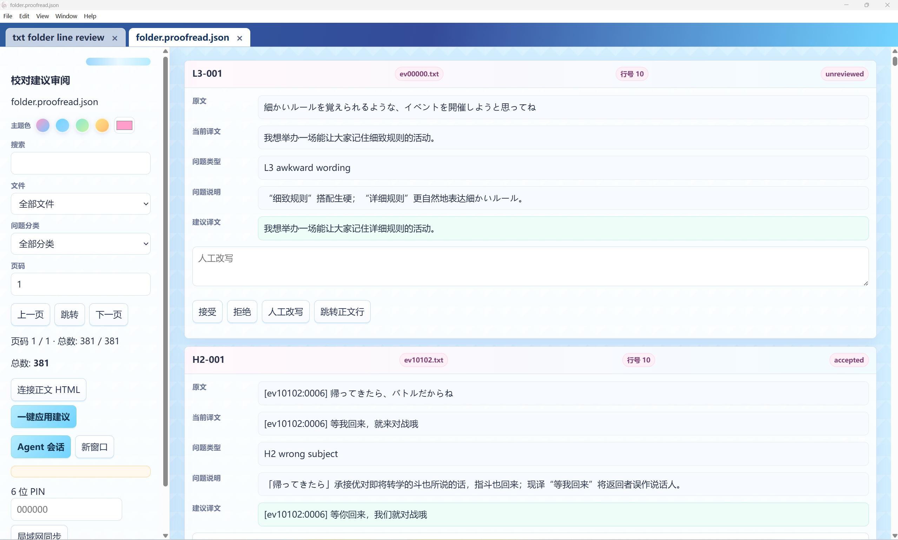

# Your first YN project

[中文](guide.md) · [Project](../README.en.md) · [Full settings](features.en.md)

These instructions describe 2.2.0. Try a small sample before a whole novel or game-text batch.

## Download and model

Get the Windows installer or portable build from [Releases](https://github.com/TohmaN233/YN-translation-workshop/releases). Configure the provider, model and authorization at the top of the start page. External agents use this same YN configuration.

## Create the project

Choose the source and project location. TXT supports files, folders and alternating bilingual lines. EPUB is extracted to working text; PDF requires selectable text. Original inputs remain read-only.

Set the language direction and one project style. Defaults are 500 lines per chunk and up to 3 child agents. Worker counts are concurrency ceilings.

### Glossary and characters

Prepare existing terminology, character records and notes before translation. Reference preparation can create a project without existing translated text, uses editable drafts, checks them and commits formal assets. Tables can later be viewed, edited and deleted from HTML.

## Start translating

The preparation shortcut checks settings against the text, samples preservation candidates, trials rules, then opens HTML and uses the same parameters and prompt as manual startup. Generate HTML first when you want to adjust settings yourself and invoke AI selectively.

A preservation regex protects its actual matched positions. Inspect examples so a prefix rule does not lock dialogue. Prose outside matches still needs translation. Explicitly untranslated names can be confirmed source-to-identical-target terms in the formal glossary.

## Existing translations

Bind a translation aligned with the source. Reuse mechanically screens old rows, semantically audits risky ones, then asks for one batch decision. Accepted rows remain; only actual retranslation debt goes back to translation. Resolve binding or line-count mismatches first.

## Proofread and write

Proofreading requires an existing translation. Split review checks each assigned row; Monte Carlo uses stratified sampling.

Auto-apply affects HTML only. Review the result, then write TXT or batch-write files; EPUB/PDF have export controls. Candidate refresh, HTML editing and final file output are separate operations.

## PDF, code and formulas

Use text-layer PDFs. YN extracts prose, code/math glyphs and figures, organizes logical structure mechanically, then uses the current model for structure corrections and an independent audit before review HTML is generated. Translate editable prose while code, formulas and references retain source glyphs. Export reconstructs structured HTML from current translations and assets, then reflows it into a new PDF without original prose-box length limits. Opening existing HTML does not rerun structure models. See the [PDF guide](pdf.en.md) for supported inputs and asset limits.

## Stop and move projects

Stop and wait for cleanup before closing or moving files. Resume verifies drafts and proof before model calls. Restore missing bound files rather than repeatedly asking the model to retry. Internal bindings resolve relative to the project root; transfer and rebind external sources, PDFs and references too.

## Phones and LAN

Enable desktop LAN sharing, set a PIN and open the displayed address on the other device. Edit translations, review suggestions and use the same Agent session while desktop YN stays running. Public tunnels are external tools; protect the PIN and address.

## External agents in the background

Give Codex or another agent the [official Agent API guide](agent-api.en.md). It must show location, model and full settings, wait for user confirmation, then prepare and start. The API is local stdio with a launcher, not a public network service. It uses YN's configured model, not the external agent's chat model.
