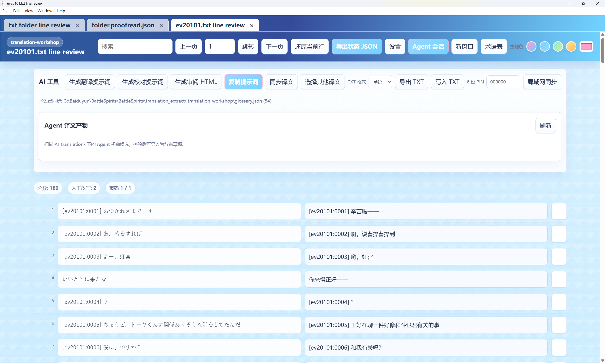

# 第一次使用 YN

[English](guide.en.md) · [首页](../README.md) · [完整参数](features.md)

本页对应 2.2.0。先用一小段原文跑通流程，再处理整本小说或整批游戏文本。

## 下载与模型

从 [Releases](https://github.com/TohmaN233/YN-translation-workshop/releases) 下载 Windows 安装版或便携版。在首页顶部配置供应商、模型和授权。AI 任务使用 YN 的配置；外部 Agent 发起任务也一样。

## 创建项目

选择原文和项目保存位置。TXT 支持单文件、文件夹与相邻行双语；EPUB 会提取工作文本；PDF 需有可选中文字。原输入保持只读。

语言方向和翻译风格是项目参数。默认每块 500 行、最多 3 个子 Agent；数量是并发上限，不是必须同时启动的工人数。

### 译名表与角色表

已有译名表、角色表或设定资料时，先使用资料整理入口。它可先创建项目，不要求已有译文；先修改并核查草稿，再提交正式表。开始翻译后也可在 HTML 中查看、编辑或删除条目。

## 启动翻译

简便启动会先核对参数与实际内容、抽样发现控制符保留候选、试跑规则，然后打开 HTML 并使用与手动翻译相同的参数和提示词。你也可以先生成行对行 HTML，自行调整参数，再按需调用 AI。

保留正则按实际匹配位置保护内容。例如要保留行首 `abc:`，先查看是否只匹配前缀；不要锁住完整台词。规则外正文仍需翻译。用户明确要求不翻译的人名可记录为正式表中的“源词 → 原词”。

## 使用已有译文

绑定与原文行数对应的译文。旧译复用先机械快筛，再对风险行做语义审计；一次确认后保留可复用内容，只重译需要修复的行。译文与当前原文不匹配时，先解决绑定或行对齐问题。

## 校对与写出

校对必须已有译文。逐片精审检查负责范围的每一行；Monte Carlo 是分层抽样，不能把未检查行说成已完整校对。

自动应用选项只把意见应用到 HTML。手动审阅后点击写入 TXT 或批量写入；EPUB/PDF 使用相应导出。刷新候选和 HTML 编辑状态与最终文件写出是不同动作。

## PDF、代码和公式

选择文字层 PDF。YN 先提取正文、代码／公式字形和图表等资产，机械整理逻辑结构，经过当前模型的结构修订和独立审计后生成审阅 HTML。模型翻译可译正文，代码、公式及参考文献保留原始字形。导出用当前译文和源资产重建结构化 HTML，再自动重排生成新 PDF，无原正文文本框长度限制。已有 HTML 打开不重新跑结构模型。支持范围和资产限制见 [PDF 说明](pdf.md)。

## 中断与项目搬移

先使用停止按钮并等待收尾，再关闭或搬移项目。恢复在调用模型前核查草稿和证据；必需绑定文件丢失时恢复文件，不要让模型反复重试。项目内路径按项目根解码；项目外原文、PDF 或参考需一并拷贝并重新绑定。

## 手机与局域网

在桌面应用开启 LAN 同步并设置 PIN，手机或平板打开页面给出的地址。可编辑译文、审阅建议和使用同一 Agent 会话；桌面 YN 必须持续运行。公网隧道由外部工具提供，请保护 PIN 和访问地址。

## 让外部 Agent 在后台使用

给 Codex 等 Agent 阅读 [官方 Agent API](agent-api.md)：先展示项目位置、模型和完整参数，得到用户确认后再准备并启动。接口是本地 stdio 协议与启动器，不是公开的网络服务；任务使用 YN 配置的模型，不使用外部 Agent 对话中的模型。
